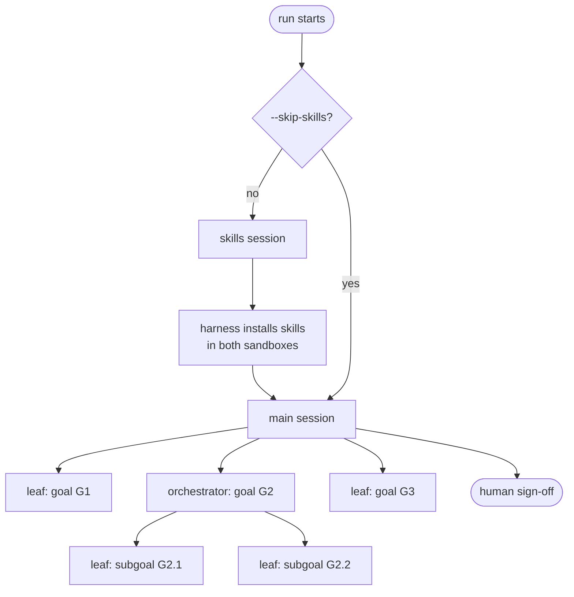
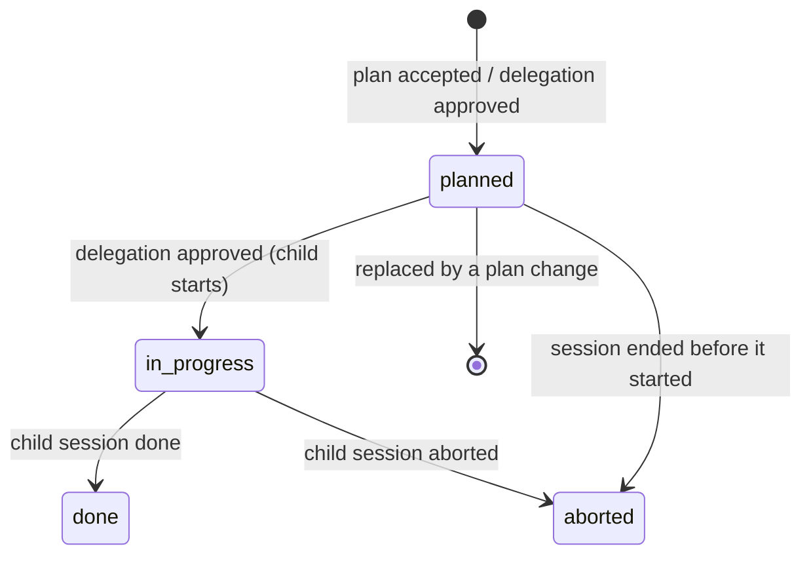
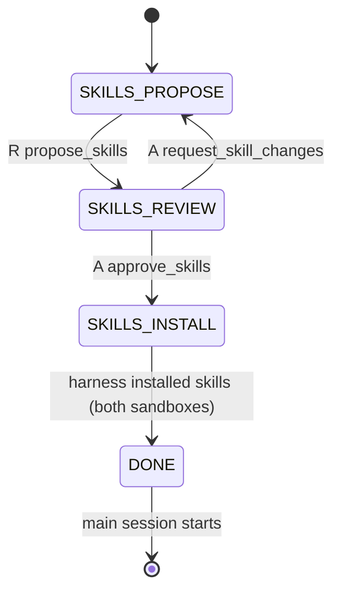
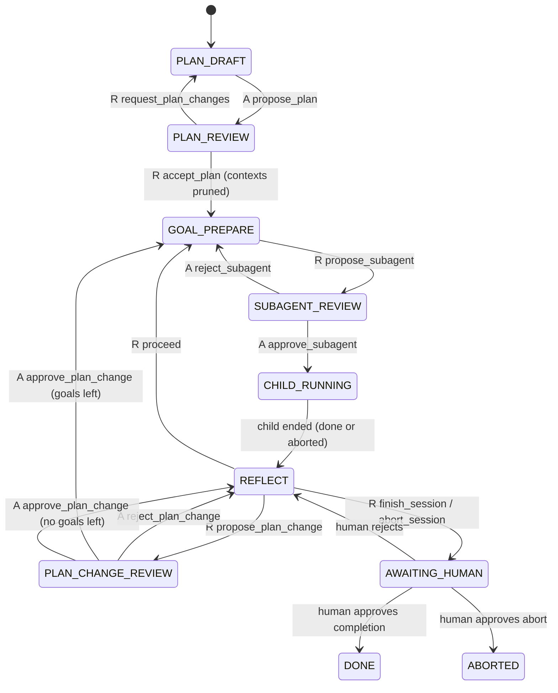
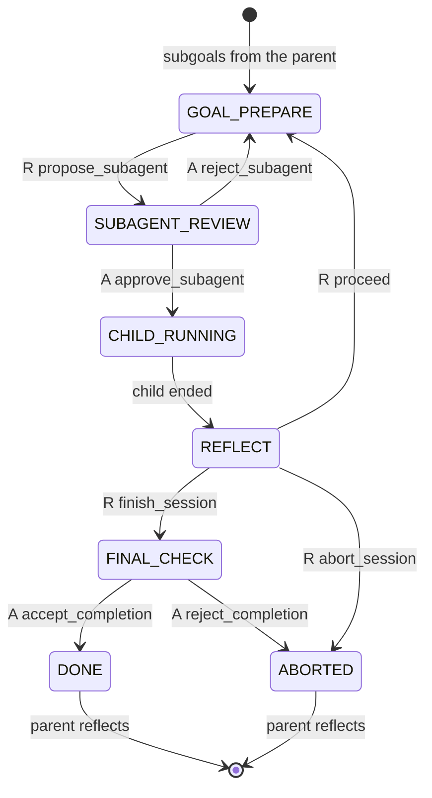
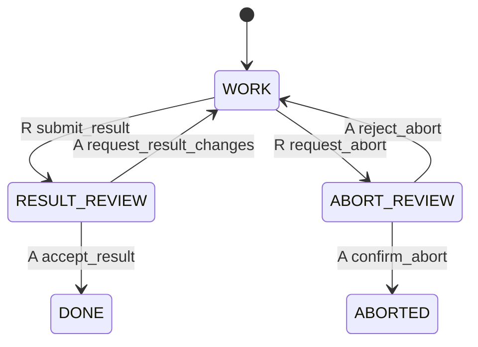

# Research-loop protocol (v2)

This document is the specification of how a run proceeds: which agent acts
when, what it may do, and how goals are tracked. The control plane enforces it
strictly: an agent can only end its turn with one of the control tools allowed
in the current state, and anything else is rejected with a correction prompt.

The transition table at the end is generated from the code
(`control-plane/state-machine.mjs`); a test checks that this document and the
code agree.

## Overview

A run is a tree of **sessions**. Every session is a researcher/advisor pair
with its own conversations (a fresh context for both agents). Exactly one
session is active at a time; a session that started a child is paused until the
child finishes.

| Session kind | Started by | Works on | Researcher | Advisor |
|---|---|---|---|---|
| `skills` | the harness, first (optional) | finding Agent Skills for the task | proposes skills | approves skills |
| `main` | the harness, after `skills` | the human's task | reviews the plan, delegates every goal, reflects | writes the plan, approves delegations and plan changes |
| `orchestrator` | a parent (goal split into subgoals) | one goal, via its subgoals | delegates every subgoal, reflects | approves delegations, checks the goal is met |
| `leaf` | a parent (goal delegated in full) | one goal, directly | does the work | verifies the result |

Only a **leaf** researcher implements anything: it has bash and file-writing
tools. Researchers of `main` and `orchestrator` sessions only have read-only
file tools (`list_dir`, `read_file`, `grep`, `read_image`). Every agent has the
read-only goal tools `list_goals` and `read_goal`.

## Goals

Goals are owned by the harness. Agents never edit a goals file; they create and
change goals only through control tools, and read them with `list_goals` /
`read_goal`.

A goal has:

- `id`: chosen by the agent, `[A-Za-z0-9._-]+`, unique across the whole run.
  Agents may use ids to express closeness (`G1.1` plan the survey, `G1.2` run
  it). Subgoals of a goal must start with the goal's id and a dot (subgoals of
  `G2` are `G2.1`, `G2.2`, ...).
- `title`: one line.
- `description`: markdown. Written for a *different* agent: specific enough to
  be understood without the conversation that produced it.
- `acceptance`: a list of observable outcomes a reviewer can check. They are a
  floor, not the definition of done: a goal is met only when the intent of its
  description is achieved (passing tests alone is not an outcome).
- `skills`: names of installed skills relevant to the goal.
- `status`: `planned`, `in_progress`, `done` or `aborted`.

Plus what the harness records as the goal is worked on: the delegation
(`mode`, `instructions`, advisor `conditions`), the child session that worked on
it, and when it ends the child's **report** (for the parent: what was done,
evidence, deviations), **notes** (for later agents: gotchas, environment facts)
and the reviewing advisor's **verdict**.

Goals of a session form an ordered list. They are worked on in order: the
current goal is always the first `planned` one.

- **Plans.** The main session's goal list is written by its advisor
  (`propose_plan`) and accepted by its researcher. An orchestrator's list (its
  subgoals) is given by the parent researcher when it delegates the goal with
  `mode: "split"`, and approved by the parent advisor.
- **Plan changes** (main session only, during reflection): `propose_plan_change`
  replaces *all* goals that are still `planned` with a new list; `done`,
  `aborted` and `in_progress` goals are never changed. The main advisor approves
  or rejects it. Replaced goals are not kept in the goal list, but every plan
  version is written to the run folder.
- **An orchestrator cannot change its plan.** If its subgoals no longer make
  sense it aborts with a proposal, and its parent re-plans in its own
  reflection.
- When a session ends early, its remaining `planned` goals become `aborted`
  ("not started").

### Status transitions

## Session state machines

States name the agent that must act. `harness` states are handled by the control
plane itself; `human` states wait for the person supervising the run.

### Skills session (`skills`, optional)

The researcher searches skills.sh (`npx skills find`) and proposes a set (or
`noneNeeded`). After approval the harness installs the skills into
`/sandbox/skills` of **both** agents (the agent processes run the installer
themselves; no model is involved), then closes both conversations and starts
the main session. Skills already present in the initial sandbox are copied to
the advisor's sandbox at startup. With `--skip-skills` this session is not run.

### Main session (`main`)

1. **Plan.** The advisor receives the task and breaks it into goals
   (`propose_plan`). The researcher reviews the plan for organisation and
   clarity (not feasibility) and either accepts it or requests changes.
2. **Compaction.** When the plan is accepted, both agents' contexts are pruned:
   every tool call and tool result is removed except the accepted
   `propose_plan` / `accept_plan` calls. Reasoning and messages are kept as the
   record of why the plan looks the way it does.
3. **Delegate.** For the current goal the researcher prepares a subagent
   (`propose_subagent`): either `mode: "full"` (a leaf implements the whole
   goal) or `mode: "split"` with a list of subgoals (an orchestrator works
   through them). A justification of the scope decision is required. The
   advisor approves or rejects it, focusing on scope: is the goal sensible as
   one unit of work, and is a split justified?
4. **Reflect.** When the child ends, the researcher receives its outcome
   (status, report, notes, verdict) and decides: `proceed` to the next goal,
   `propose_plan_change` (the advisor signs off), `finish_session` when no
   planned goals are left, or `abort_session`.
5. **Human.** Finishing or aborting goes to the human. Approval ends the run;
   rejection returns the researcher to reflection with the human's feedback.

### Orchestrator session (`orchestrator`)

Like the main session from step 3 on, with three differences: its subgoals were
given by the parent; it cannot change them (it aborts with a proposal instead);
and when all subgoals are done its advisor checks that the session's own goal
is actually met as a whole (`FINAL_CHECK`). A rejected final check ends the
session as aborted, with the advisor's reasons, so the parent can re-plan.

### Leaf session (`leaf`)

The researcher works on the goal directly (there is no separate plan step: the
goal and the instructions were already approved one level up) and submits the
result with its report and notes. The advisor verifies it against the goal's
description and acceptance criteria. If the goal turns out to be infeasible or
much larger than expected, the researcher may request an abort (with a report
and a proposal); the advisor confirms or rejects it.

## What each child receives

A new child session starts with a fresh context containing:

- the overall task (for context) and the chain of goals above it;
- its goal (description, acceptance criteria, skills) and, for an orchestrator,
  its subgoals;
- the parent's instructions and the approving advisor's conditions;
- the outcome and **notes** of every finished sibling goal (reports are left
  out; `read_goal` shows them on request).

When a child ends, the parent researcher receives its status, report, notes
and verdict; the parent advisor receives a short summary with its next handoff.

## Limits

All limits are off by default and set by orchestrator flags:

- `--max-subagent-depth N` (default unlimited, minimum 1): nesting depth of
  subagents. A child at the maximum depth must be a leaf (`mode: "split"` is
  refused).
- `--max-plan-changes N`: approved plan changes in the main session; once
  reached, `propose_plan_change` is refused.
- `--max-subagent-rejections N`: rejected delegations per goal; once reached,
  the session ends as aborted (the main session goes to the human).
- `--max-handoffs N`: accepted handoffs in the whole run; once reached, the run
  is aborted.

## Run folder

The control plane's own log, `control/session.jsonl`, is the source of truth:
`--resume` rebuilds every session and goal from it. It lives outside every
directory mounted into the agent containers. Human-readable views are written
next to it:

- `goals.md`: the current goal tree with statuses, regenerated on every change;
- `plans/<session>/v<N>.md` (and `.json`): every plan version of a session;
- `agents/<id>/`: per-session records (`agent.json`, `instructions.md`,
  `report.md`, `notes.md`);
- `skills.json`: the approved skills and what was installed where.

## Transition table

Generated from `control-plane/state-machine.mjs`; `R` = researcher,
`A` = advisor.

<!-- BEGIN GENERATED TRANSITIONS -->
| Session | From | Actor | Action | To | When |
|---|---|---|---|---|---|
| skills | SKILLS_PROPOSE | R | `propose_skills` | SKILLS_REVIEW |  |
| skills | SKILLS_REVIEW | A | `request_skill_changes` | SKILLS_PROPOSE |  |
| skills | SKILLS_REVIEW | A | `approve_skills` | SKILLS_INSTALL | skills to install |
| skills | SKILLS_REVIEW | A | `approve_skills` | DONE | nothing to install |
| skills | SKILLS_INSTALL | harness | `skills_installed` | DONE | both sandboxes installed |
| main | PLAN_DRAFT | A | `propose_plan` | PLAN_REVIEW |  |
| main | PLAN_REVIEW | R | `request_plan_changes` | PLAN_DRAFT |  |
| main | PLAN_REVIEW | R | `accept_plan` | GOAL_PREPARE |  |
| main, orchestrator | GOAL_PREPARE | R | `propose_subagent` | SUBAGENT_REVIEW |  |
| main, orchestrator | SUBAGENT_REVIEW | A | `reject_subagent` | GOAL_PREPARE | below rejection cap |
| main | SUBAGENT_REVIEW | A | `reject_subagent` | AWAITING_HUMAN | rejection cap reached |
| orchestrator | SUBAGENT_REVIEW | A | `reject_subagent` | ABORTED | rejection cap reached |
| main, orchestrator | SUBAGENT_REVIEW | A | `approve_subagent` | CHILD_RUNNING |  |
| main, orchestrator | CHILD_RUNNING | harness | `child_ended` | REFLECT |  |
| main, orchestrator | REFLECT | R | `proceed` | GOAL_PREPARE | planned goals left |
| main | REFLECT | R | `propose_plan_change` | PLAN_CHANGE_REVIEW |  |
| main | REFLECT | R | `finish_session` | AWAITING_HUMAN | no planned goals left |
| main | REFLECT | R | `abort_session` | AWAITING_HUMAN |  |
| orchestrator | REFLECT | R | `finish_session` | FINAL_CHECK | no planned goals left |
| orchestrator | REFLECT | R | `abort_session` | ABORTED |  |
| main | PLAN_CHANGE_REVIEW | A | `reject_plan_change` | REFLECT |  |
| main | PLAN_CHANGE_REVIEW | A | `approve_plan_change` | GOAL_PREPARE | planned goals left |
| main | PLAN_CHANGE_REVIEW | A | `approve_plan_change` | REFLECT | no planned goals left |
| orchestrator | FINAL_CHECK | A | `accept_completion` | DONE |  |
| orchestrator | FINAL_CHECK | A | `reject_completion` | ABORTED |  |
| main | AWAITING_HUMAN | human | `human_approve` | DONE | completion requested |
| main | AWAITING_HUMAN | human | `human_approve` | ABORTED | abort requested |
| main | AWAITING_HUMAN | human | `human_reject` | REFLECT |  |
| leaf | WORK | R | `submit_result` | RESULT_REVIEW |  |
| leaf | WORK | R | `request_abort` | ABORT_REVIEW |  |
| leaf | RESULT_REVIEW | A | `request_result_changes` | WORK |  |
| leaf | RESULT_REVIEW | A | `accept_result` | DONE |  |
| leaf | ABORT_REVIEW | A | `reject_abort` | WORK |  |
| leaf | ABORT_REVIEW | A | `confirm_abort` | ABORTED |  |
<!-- END GENERATED TRANSITIONS -->
